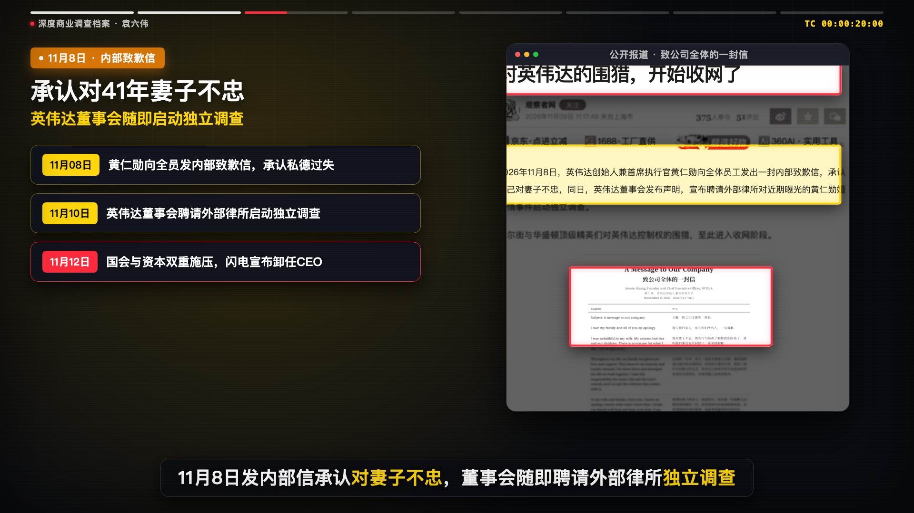
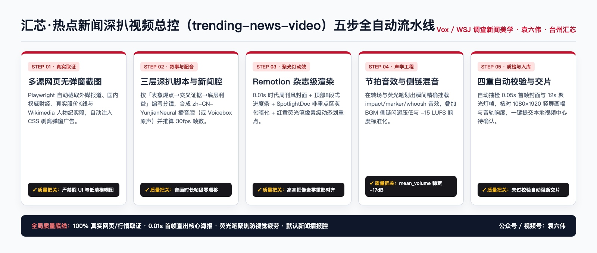

<div align="center">


# 汇芯·热点新闻深扒视频总控
### `trending-news-video-skill` · 竖屏 3:4 杂志封面 (`1080×1440`) + 横屏 16:9 调查正片 (`1920×1080`) + 袁六伟原声 + 侧链混音

[](https://agentskills.io)
[](#五环境依赖与-3-分钟安装)
[](#三五步全自动流水线与质量把关)
[](LICENSE)

> 🔴 **作者：袁六伟 · 台州汇芯**｜一人 AI 公司创业者，学员 7000+，客户 100+，得到 / 华为分享老师  
> 📮 更多 AI 视频与自动化实战，关注 **公众号 / 视频号：袁六伟**

**告别干瘪口播与满屏看不清的网页截图，把每一条科技/商业热点做成 95 分《经济学人》/ Vox 级深度调查短视频。**  
给它一个热点事件或分镜配置，全自动跑完：**Playwright 多源无弹窗网页/行情取证 → 三层剥洋葱商业博弈脚本 → 默认袁六伟本人 Voicebox 原声与 16 处节拍音效帧级对齐 → Remotion 16:9 横屏聚光灯背景灰化 + 红黄荧光笔划重点 + 3:4 竖屏杂志封面渲染 → 侧链闪避 BGM 与 `-15 LUFS` 响度标准化 → 自动推送本地视频中心**。

```bash
# 一键安装 Skill
npx skills add sixwei2025/trending-news-video-skill

# 一键运行完整热点深扒视频产线（配音+音效+Remotion 16:9正片与3:4封面渲染+BGM侧链混音+自动质检）
python3 skills/trending-news-video/scripts/build_news_video.py \
  --project-dir ~/热点视频_黄仁勋 \
  --config skills/trending-news-video/templates/story_config.example.json \
  --voice yuanliuwei
```

[看真实成片画廊](#一看真实成片效果与正反对比) · [一句话快速开始](#二一句话快速开始) · [五步全自动流水线](#三五步全自动流水线与质量把关) · [核心视觉与声学公式](#四高频翻车点根治方案与核心公式) · [安装与目录结构](#五环境依赖与仓库结构)

</div>

## 版本记录

当前版本：`v1.2.0` · 2026-11-13
完整变化记录见 [CHANGELOG.md](CHANGELOG.md)。


## 新手安装：把链接发给 AI

打开 Codex、WorkBuddy，或其他支持技能安装的 AI 智能体，把下面这段话发到对话框，让它帮你安装：

```text
帮我安装这个仓库里的技能：
https://github.com/sixwei2025/trending-news-video-skill
```

安装后可以问：“这个技能怎么用？带我做一个最简单的例子。”

说明适用于能读取仓库、操作本地文件并支持技能安装的 AI，不承诺任意聊天平台都能安装；依赖软件（Node.js、Python 3.10+、FFmpeg、Playwright）和账号配置按实际说明分步完成。安装本配套 Skill 与安装独立桌面应用属于不同步骤。

---

## 一、看真实成片效果与正反对比

以下画面全部由本 Skill（`trending-news-video`）**真实渲染导出**，所有新闻报道与股价行情均为 Playwright 实时无弹窗取证截图：

| 竖屏 3:4 杂志级封面 (`1080×1440`) | 16:9 横屏正片：真实行情聚光灯划重点 | 16:9 横屏正片：内部致歉信与72h时间轴 |
| :---: | :---: | :---: |
|  |  |  |
| 竖屏 3:4 满出血人物纪实照 + 暴跌取证卡 | 16:9 左文右证 + 实时跳动计数器 + 原彩荧光框 | macOS 3D 取证框 + 72h 时间轴 + 毛玻璃高亮字幕 |

### 普通 AI 热点视频 vs 本 Skill 交付标准

| 维度 | 普通 AI 热点视频（10分翻车现场） | 汇芯·热点新闻深扒视频总控（95分杂志级标准） |
| :--- | :--- | :--- |
| **封面与前 0.5s** | 白字黑底或 AI 假人像，左上角堆砌无意义英文小标签 | **0.01s 时代周刊级封面**：高清纪实人物照 + 3张真实外媒/暴跌K线微缩取证卡 + 冲击力大标题 |
| **密集文字截图** | 整张网页直接干放屏幕中央，手机端字小如蚁找不到重点 | **`SpotlightDoc` 聚光灯取证窗**：非重点区域自动灰化暗化模糊，红/黄荧光笔动态划出 100% 清晰全彩重点句 |
| **配音腔调** | 用平淡聊天腔念新闻，缺乏调查报道的紧迫感与权威感 | **默认央媒/财经播音腔**（`zh-CN-YunjianNeural` `+12%` 语速 `-2Hz` 压低音调，支持参数切换 Voicebox 原声） |
| **声学设计** | 只有干瘪人声，或背景音乐喧宾夺主盖住台词 | **帧级节拍音效（Impact 重击 / Marker 荧光笔摩擦 / Whoosh 推镜）** + 侧链闪避 BGM + `-15 LUFS` 响度标准化 |

---

## 二、一句话快速开始

| 你对 Agent 说的话 | 自动执行的流水线动作 |
| :--- | :--- |
| **“帮我做一期关于【XX热点事件】的深扒视频，用新闻腔”** | 自动检索多源权威报道与股价行情 → 用 `harvest_evidence.py` 无弹窗截图 → 生成 8 幕三层博弈分镜 → 合成播音腔与节拍音效 → Remotion 渲染 1080×1920 成片并入库本地视频中心 |
| **“把这些新闻网页链接做成聚光灯划重点视频”** | 自动打开链接去广告截图 → 按核心段落坐标配置 `SpotlightDoc` 红黄荧光框 → 渲染输出带顶部章节进度条的调查短片 |
| **“用我自己的声音出一条热点商业点评视频”** | 自动传参 `--voice yuanliuwei` 调用本地 Voicebox（`127.0.0.1:17493`）克隆音色合成配音，其余视觉与混音保持杂志级标准 |

---

## 三、五步全自动流水线与质量把关

<p align="center">
  
</p>

| 步骤 | 核心脚本 / 组件 | 输入 | 自动化动作与质量把关指标 | 输出产物 |
| :--- | :--- | :--- | :--- | :--- |
| **Step 01**<br>多源真实取证 | [`harvest_evidence.py`](skills/trending-news-video/scripts/harvest_evidence.py) | `story_config.json` | Playwright `2x` 高分屏截取外媒、国内财经与股价行情，自动注入 CSS 清除 Cookie 弹窗与横幅广告 | `assets/*.png`<br>`assets/*.jpg` |
| **Step 02**<br>播音腔与音效 | [`generate_tts_and_sfx.py`](skills/trending-news-video/scripts/generate_tts_and_sfx.py) | 分镜台词文本 | 合成 `zh-CN-YunjianNeural` 新闻腔干声，按 `30fps` 精确反推每幕帧数；程序化合成 `impact` / `marker` / `whoosh` 三类音效 | `voice_full.wav`<br>`timings.json`<br>`sfx/*.wav` |
| **Step 03**<br>杂志级渲染 | [`SpotlightDoc.tsx`](skills/trending-news-video/templates/remotion_news_kit/src/components/SpotlightDoc.tsx) | 证据图 + 高亮坐标 | 渲染 0.01s 封面 `CoverStill`、顶部 8 段进度条、背景灰化 `92%` + 荧光笔像素级对齐原彩透出、底部毛玻璃高亮字幕 | `cover.png`<br>`remotion_raw.mp4` |
| **Step 04**<br>侧链闪避混音 | [`build_news_video.py`](skills/trending-news-video/scripts/build_news_video.py) | 裸片 + 干声 + BGM | 在每幕转场与 `+14f/+28f` 荧光笔划出瞬间挂载音效，启用 `sidechaincompress` 压低 BGM 并完成响度标准化 | `output_final.mp4` |
| **Step 05**<br>四重质检与入库 | [`audit_news_video.py`](skills/trending-news-video/scripts/audit_news_video.py)<br>[`push_video_hub.py`](skills/trending-news-video/scripts/push_video_hub.py) | 最终成片与封面 | 自动核对 `1080×1920` 画幅、音轨响度（`-26dB ~ -10dB`）并抽检 0.05s/12s 关键帧；校验通过后提交 `video-hub` 待确认 | `qa/*.png`<br>视频中心工单 |

---

## 四、高频翻车点根治方案与核心公式

1. **解决荧光笔局部放大文字错位重影（外框固定像素反推公式）**：
   - 在 Remotion 中做局部聚光灯全彩透出时，若内层 `` 用百分比宽度 `10000 / hl.w %`，会随高亮框尺寸变化产生严重错位。
   - 本 Skill 在 [`SpotlightDoc.tsx`](skills/trending-news-video/templates/remotion_news_kit/src/components/SpotlightDoc.tsx) 中锁定外框像素尺寸 `cardWidth × cardH`，内层全彩原图容器使用绝对像素反向偏移 `left: -(hl.x / 100) * cardWidth`、`top: -(hl.y / 100) * cardH`，实现动态划重点过程中 100% 像素级严丝合缝。
2. **解决网页截图满屏 Cookie 遮罩**：
   - [`harvest_evidence.py`](skills/trending-news-video/scripts/harvest_evidence.py) 内置去弹窗 CSS 规则（自动隐藏 `#onetrust-consent-sdk`、`[class*="cookie"]`、`[class*="modal"]` 等遮挡层），确保截出来的每一帧外媒报道干净利落。
3. **解决配乐盖过新闻播报人声**：
   - 采用 `sidechaincompress=threshold=0.015:ratio=6:attack=15:release=280` 强侧链压缩，只要播音员开口，背景音乐自动压低至 `-34 dB` 以下；气口停顿处音乐自然回升托底。

---

## 五、环境依赖与仓库结构

```text
trending-news-video-skill/
├── README.md                                            # 仓库总览与真实成片展示
├── LICENSE                                              # MIT 开源协议
├── assets/showcase/                                     # 首屏横幅、五步架构图与真实成片抽帧
└── skills/trending-news-video/
    ├── SKILL.md                                         # 【总控入口】五步闭环工作流与视觉声学规范
    ├── QUICKSTART.md                                    # 3 分钟上手指南
    ├── examples/                                        # 真实渲染出的封面与聚光灯抽帧样本
    ├── references/
    │   ├── vox-editorial-playbook.md                    # Vox/WSJ 三层剥洋葱叙事与像素对齐规范
    │   └── open-source-credits.md                       # GitHub 五大开源项目融合致谢
    ├── templates/
    │   ├── story_config.example.json                    # 8 幕商业热点深扒标准分镜配置模板
    │   └── remotion_news_kit/                           # Remotion 4.0 调查新闻视觉组件库
    └── scripts/
        ├── harvest_evidence.py                          # Playwright 多源网页无弹窗取证脚本
        ├── generate_tts_and_sfx.py                      # 新闻腔 TTS + 30fps 时间轴 + 节拍音效合成器
        ├── build_news_video.py                          # 一键串联渲染与侧链混音总控脚本
        ├── audit_news_video.py                          # 四重自动质检脚本（画幅/时长/响度/关键帧）
        └── push_video_hub.py                            # 自动入库本地视频中心（127.0.0.1:8765）
```

### 开源致谢（Credits）
本仓库在研发过程中借鉴并致谢以下开源项目：
- `htlin222/vox-styled-reels` & `Anil-matcha/vox-ai-motion-graphics-generator`（Vox 报刊拼贴与荧光笔划重点范式）
- `social-media-skills/remotion-shorts-skill`（竖屏黄金前 3 秒钩子与阅读节奏控制）
- `reactvideoeditor/remotion-templates` & `manalkaff/remotion-prompts`（3D 微倾角网页取证窗与新闻进度条组件）
- `calesthio/OpenMontage`（纪实影像档案检索与多阶段导演工作流）

---

## 关于作者与开源生态

**袁六伟 · 台州汇芯**：一人 AI 公司创业者，学员 7000+，服务商单客户 100+，覆盖近 20 个行业，得到 / 华为分享老师。AI 变现实战派，自己跑通才拿出来教。

- 公众号：**袁六伟**（微信搜一搜关注，看更多 AI 工具实测与一人公司实战）
- 视频号：**袁六伟**

这个项目免费开源。如果它帮你的产线省下了每天反复返工的时间，欢迎在右上角点个 ⭐ **Star**，也欢迎转发给身边做内容或一人公司的朋友。

### 同系列开源 Skill 矩阵（袁六伟 · 台州汇芯）

| 仓库 | 领域 | 核心能力 |
| :--- | :--- | :--- |
| [**trending-news-video-skill**](https://github.com/sixwei2025/trending-news-video-skill) | 短视频工程 | 真实外媒/行情取证 + 聚光灯灰化划重点 + 央媒播音腔 + Remotion 杂志级热点深扒视频 |
| [**auto-tutorial-skill**](https://github.com/sixwei2025/auto-tutorial-skill) | 短视频工程 | 链接/网页/真机截图 → 3:4 封面 + 1.5x 配音 + 红框标注教程视频 |
| [**talking-head-video-skill**](https://github.com/sixwei2025/talking-head-video-skill) | 短视频工程 | 1080×1920 竖屏真人口播短视频（ASR 错字校对 + 逐字卡拉OK字幕 + 6项QC） |
| [**3d-map-video-skill**](https://github.com/sixwei2025/3d-map-video-skill) | 短视频工程 | MapLibre 3D 地形 + WarFX 战争特效（粒子行军/点阵兵力/震屏混音） |
| [**psych-kepu-video-skill**](https://github.com/sixwei2025/psych-kepu-video-skill) | 短视频工程 | Remotion + JSON 驱动的 15–30s 深色扁平动画心理科普短视频 |
| [**dark-infographic-video-skill**](https://github.com/sixwei2025/dark-infographic-video-skill) | 短视频工程 | 纯 Python + FFmpeg 暗黑流光数据可视化科普片（含 v2 手机外放配乐） |
| [**workbuddy-wechat-autopilot**](https://github.com/sixwei2025/workbuddy-wechat-autopilot) | 公众号全链路 | 九步全自动总控：选题→写稿→真实截图→6套封面→6套排版→三重自动质检→草稿箱 |
| [**wechat-cover-skill**](https://github.com/sixwei2025/wechat-cover-skill) | 公众号视觉 | 封面渲染引擎（6套高客单价杂志风 + 黑红金 v2b + 防压脸自动校验） |
| [**gzh-million-layout-skill**](https://github.com/sixwei2025/gzh-million-layout-skill) | 公众号排版 | 汇芯红 `#C8102E` 六套 100% 内联 CSS 骨架 + 零乱码排版检查 + 配图皮肤 |
| [**ai-tool-review-wechat-skill**](https://github.com/sixwei2025/ai-tool-review-wechat-skill) | 公众号评测 | AI 工具真跑评测工作流（2.0 全自动压测 + 真人语感质检 + 六套骨架装配） |
| [**hit-title-expert-skill**](https://github.com/sixwei2025/hit-title-expert-skill) | 爆款标题 | 一次直出 10 条 14–22 字高浓缩狠标题（5大公式 × 5类钩子词） |
| [**local-video-hub**](https://github.com/sixwei2025/local-video-hub) | AI 团队基建 | 视频版本地 Obsidian：多 AI 员工统一交片、70% 撞题自动查重与四态流转云台 |
| [**yuanliuwei-ai-skills**](https://github.com/sixwei2025/yuanliuwei-ai-skills) | 一人公司方法 | PACT 72h 需求验证模型与一人 AI 公司 10 大业务决策模块 |
| [**book-skill**](https://github.com/sixwei2025/book-skill) | 知识工程 | 上传任意书籍 PDF → 自动提炼方法论生成 `.skill` + 公众号导流文案 |
| [**huangdi-skill**](https://github.com/sixwei2025/huangdi-skill) | 认知操作系统 | 中国历史八大皇帝（秦始皇/汉武帝/唐太宗等）一手史料认知框架蒸馏 |
| [**sunrise-tracker**](https://github.com/sixwei2025/sunrise-tracker) | 选题雷达 | 小红书 AI 赛道 10 倍异常流量「低粉爆文」每日早 7 点监测推送 |
