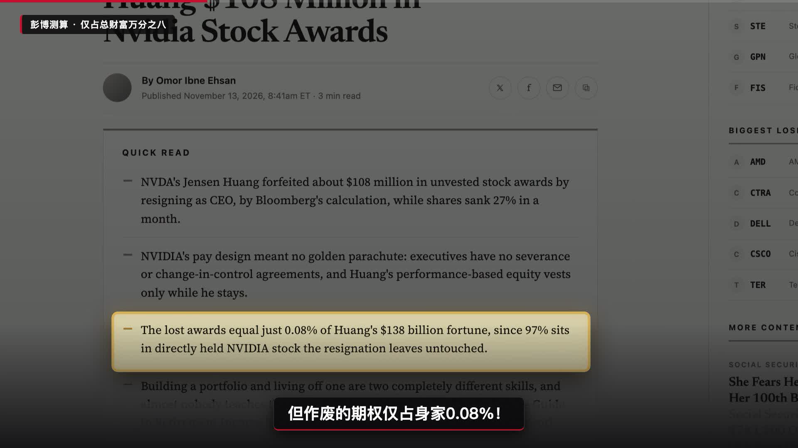

<div align="center">


# 汇芯·热点新闻深扒视频总控
### `trending-news-video-skill` · 竖屏 3:4 汇芯红封面 (`1080×1440`) + 横屏 16:9 调查正片 (`1920×1080` 首帧内嵌) + 袁六伟原声 + 26 镜快切

[](https://agentskills.io)
[](#五环境依赖与仓库结构)
[](#三五步全自动流水线与质量把关)
[](LICENSE)

> 🔴 **作者：袁六伟 · 台州汇芯**｜台州汇芯创始人，得到 / 华为的分享老师，多家企业的 AI 落地顾问，一人 AI 公司实战派（学员 7000+，客户 100+，覆盖近 20 个行业）  
> 📮 更多 AI 视频与自动化实战，关注 **公众号 / 视频号：袁六伟**

**告别干瘪口播、催眠 PPT 幻灯片与满屏看不清的小字网页截图，把每一条科技/商业热点做成破 10w+ 的 Vox /《经济学人》级深度调查短视频。**  
给它一个热点事件或 `story_config.json`，全自动跑完：**10w+ 泛人群痛点切角 → Playwright 无弹窗 SEC/新闻取证与实拍视频转码 → 默认袁六伟本人 Voicebox 原声与 18 处节拍音效帧级对齐 → Remotion 16:9 全画幅聚光灯原彩划重点 + 3:4 汇芯红封面渲染（自动内嵌第 0.01s 首帧安全区）→ 侧链闪避 BGM 与 `-15 LUFS` 响度标准化 → 六项自动质检并入库本地视频中心**。

```bash
# 一键安装 Skill
npx skills add sixwei2025/trending-news-video-skill

# 一键运行完整热点深扒视频产线（配音+音效+Remotion 16:9快切正片与3:4封面渲染+BGM侧链混音+六项质检）
python3 skills/trending-news-video/scripts/build_news_video.py \
  --project-dir ~/热点视频_黄仁勋 \
  --config skills/trending-news-video/templates/story_config.example.json \
  --voice yuanliuwei
```

[看真实成片画廊](#一看真实成片效果与正反对比) · [一句话快速开始](#二一句话快速开始) · [五步全自动流水线](#三五步全自动流水线与质量把关) · [核心视觉与声学公式](#四高频翻车点根治方案与核心公式) · [安装与目录结构](#五环境依赖与仓库结构)

</div>

## 版本记录

当前版本：`v2.0.0` · 2026-11-14  
完整变化记录见 [CHANGELOG.md](CHANGELOG.md)。

## 新手安装：把链接发给 AI

打开 Codex、WorkBuddy，或其他支持技能安装的 AI 智能体，把下面这段话发到对话框，让它帮你安装：

```text
帮我安装这个仓库里的技能：
https://github.com/sixwei2025/trending-news-video-skill
```

安装后可以问：“这个技能怎么用？带我做一个最简单的例子。”

说明适用于能读取仓库、操作本地文件并支持技能安装的 AI，不承诺任意聊天平台都能安装；依赖软件（Node.js、Python 3.10+、FFmpeg、Playwright）和账号配置按实际说明分步完成。安装本配套 Skill 与安装独立桌面应用属于不同步骤。

---

## 一、看真实成片效果与正反对比

以下画面全部由本 Skill（`trending-news-video v2.0`）**真实渲染导出**，所有 SEC 官方申报表、新闻报道与实拍镜头均为无弹窗真实素材：

| 竖屏 3:4 汇芯品牌红封面 (`1080×1440`) | 16:9 正片：全画幅聚光灯原彩划重点 | 16:9 正片：结尾 7 天离岗灵魂反问卡 |
| :---: | :---: | :---: |
|  |  |  |
| 汇芯红 `#C8102E` + 灰化底图 + 袁六伟高清形象照防压脸 | 全画幅 `1920×1080` 灰化压暗 + 固定像素反推 100% 原彩透出 | 五次平滑推拉 + 严格单行短句字幕（`≤17` 字） |

### 普通 AI 热点视频 vs 本 Skill v2.0 交付标准

| 维度 | 普通 AI 热点视频（10分翻车现场） | 汇芯·热点新闻深扒视频总控 v2.0（95分 10w+ 爆款标准） |
| :--- | :--- | :--- |
| **选题与切角** | 照念新闻通稿或空谈宏大叙事，普通观众划走不看 | **10w+ 泛人群痛点切角三问**：切入「算大账/分家产/铁饭碗反差」+ 一手官方底层档案（如 SEC Form 4）+ 结尾 7 天离岗灵魂反问 |
| **封面与第 0.01s 首帧** | 封面比例混乱、红字糊在花哨背景上、文字压住人脸 | **竖屏 `3:4` 汇芯红细体大字报封面（`1080×1440`）**，且自动内嵌至 `16:9` 视频第 `0.01s` 首帧中央 `810×1080` 安全区 |
| **镜头节奏与字幕** | 8 张静态图一镜干放 8~10 秒，像催眠 PPT；多行字幕堆叠 | **100% JSON 数据驱动 26 镜快切（平均 ~2.1s/镜，总长 `<60s`）**，全片严格单行字幕（`≤18` 字） |
| **密集公文与网页取证** | 整张网页塞进半边小框字小如蚁，或带着门户 APP 弹窗二维码 | **`SpotlightDoc` 全画幅 `1920×1080` 聚光灯**：非重点区域灰化压暗，红/黄高亮框内 100% 像素级原彩透出 + 五次平滑推拉运镜 |
| **声学设计** | 机械合成音有死气口，或背景音乐盖住台词 | **默认袁六伟本人 Voicebox 原声（智能切除句间死气口 + 自动校准 `<59s` 黄金时长）** + 18 处节拍音效 + 侧链闪避 BGM（人声期 `<-34dB`） |

---

## 二、一句话快速开始

| 你对 Agent 说的话 | 自动执行的流水线动作 |
| :--- | :--- |
| **“帮我做一期关于【XX热点事件】的 10w+ 深扒视频”** | 先按「破 10w+ 切角三问」找到大众算账/分家产反差切口 → 调用 `harvest_evidence.py` 抓取实拍视频、SEC/官方档案与无弹窗新闻 → 合成袁六伟原声与 26 镜快切时间轴 → Remotion 渲染 `1920×1080` 正片与 `1080×1440` 封面 → 六项质检通过后入库 `video-hub` |
| **“把这些 SEC 档案和新闻网页做成聚光灯划重点视频”** | 自动调用本机 Chrome 剥离弹窗与二维码截图 → 按核心段落百分比坐标配置 `spotlight_doc` 原彩透出框 → 渲染输出带顶部汇芯红进度条与单行字幕的调查短片 |
| **“用财经播音腔出一条热点商业深评”** | 自动传参 `--voice news_anchor` 切换 `zh-CN-YunjianNeural` 播音腔，其余 26 镜快切视觉与侧链混音保持一致 |

---

## 三、五步全自动流水线与质量把关

<p align="center">
  
</p>

| 步骤 | 核心脚本 / 组件 | 输入 | 自动化动作与质量把关指标 | 输出产物 |
| :--- | :--- | :--- | :--- | :--- |
| **Step 01**<br>多源真实取证 | [`harvest_evidence.py`](skills/trending-news-video/scripts/harvest_evidence.py) | `story_config.json` | 实拍视频/GIF 自动转码 `1080p 30fps MP4`；本机 Chrome 截取外媒、SEC 档案与国内财经，自动剥离 Cookie 弹窗与高层悬浮二维码 | `assets/*.mp4`<br>`assets/*.png`<br>`assets/*.jpg` |
| **Step 02**<br>原声与快切时间轴 | [`generate_tts_and_sfx.py`](skills/trending-news-video/scripts/generate_tts_and_sfx.py) | 8 段深扒台词与 26 镜权重 | 默认合成袁六伟 Voicebox 原声，自动切除句间静音并校准至 `<59s` 黄金完播带；计算 26 个子镜头时间戳并生成 `impact` / `marker` / `whoosh` 音效 | `voice_full.wav`<br>`remotion_props.json`<br>`sfx/*.wav` |
| **Step 03**<br>全数据驱动渲染 | [`NewsBurstVideo.tsx`](skills/trending-news-video/templates/remotion_news_kit/src/NewsBurstVideo.tsx)<br>[`SpotlightDoc.tsx`](skills/trending-news-video/templates/remotion_news_kit/src/components/SpotlightDoc.tsx) | `remotion_props.json` | 渲染 `3:4` 汇芯红封面 `CoverStill`（`1080×1440`）与 `16:9` 正片 `NewsBurstVideo`（`1920×1080`，首帧 `0.00~0.12s` 内嵌安全区封面 + 全画幅聚光灯原彩透出） | `cover_3x4.jpg`<br>`remotion_raw.mp4` |
| **Step 04**<br>帧级音效与侧链混音 | [`build_news_video.py`](skills/trending-news-video/scripts/build_news_video.py) | 裸片 + 原声 + BGM | 在每处高亮框弹出帧挂载 `marker.wav`、反转卡挂载 `impact.wav`、急推镜挂载 `whoosh.wav`；启用 `sidechaincompress` 将人声期 BGM 压至 `-34dB` 以下并标准化至 `-15 LUFS` | `output_final.mp4`<br>`bgm_ducked_only.wav` |
| **Step 05**<br>六项质检与入库 | [`audit_news_video.py`](skills/trending-news-video/scripts/audit_news_video.py)<br>[`push_video_hub.py`](skills/trending-news-video/scripts/push_video_hub.py) | 最终成片与封面 | 自动核对 `1920×1080` 画幅、`3:4` 封面、`<60.5s` 时长、单行字幕、主音轨响度与侧链压低分贝，导出 4 张 `qa/` 关键帧；核验通过后提交 `video-hub` 待确认 | `qa/*.jpg`<br>视频中心工单 |

---

## 四、高频翻车点根治方案与核心公式

1. **解决全画幅聚光灯局部放大文字错位重影（画布固定像素反推公式）**：
   - 在 Remotion 中做局部聚光灯全彩透出时，若内层 `` 用百分比宽度，会随高亮框展开产生严重错位。
   - 本 Skill 在 [`SpotlightDoc.tsx`](skills/trending-news-video/templates/remotion_news_kit/src/components/SpotlightDoc.tsx) 中锁定外框画布尺寸 `1920 × 1080`，内层全彩原图容器使用绝对像素反向偏移 `left: -(hl.x / 100) * 1920`、`top: -(hl.y / 100) * 1080`，实现动态刷出重点过程中 **100% 像素级严丝合缝**。
2. **解决国内财经门户 APP 弹窗与悬浮二维码污染画面**：
   - [`harvest_evidence.py`](skills/trending-news-video/scripts/harvest_evidence.py) 除了注入去弹窗 CSS，还会在截图前执行 DOM 扫描，自动移除 `position: fixed/sticky` 且 `z-index >= 50` 的二维码浮窗与登录遮罩，并要求入片前逐张肉眼检查像素。
3. **解决配音拖沓超 60 秒与 BGM 盖过人声**：
   - [`generate_tts_and_sfx.py`](skills/trending-news-video/scripts/generate_tts_and_sfx.py) 内置句间静音切除与 `target_max_sec` 自动语速校准，确保 8 段高密度商业拆解稳定控制在 `55~58s`；配合 `sidechaincompress` 强侧链闪避，人声期间 BGM 自动压低至 `-34 dB` 以下，气口处自然回升托底。

---

## 五、环境依赖与仓库结构

```text
trending-news-video-skill/
├── README.md                                            # 仓库总览与真实成片展示
├── CHANGELOG.md                                         # 版本演进记录（当前 v2.0.0）
├── LICENSE                                              # MIT 开源协议
├── SKILL.md                                             # 根目录技能协议入口（兼容 npx skills add）
├── assets/showcase/                                     # 首屏横幅、五步架构图与真实成片抽帧
└── skills/trending-news-video/
    ├── SKILL.md                                         # 【总控入口】10w+切角三问与五步闭环工作流
    ├── QUICKSTART.md                                    # 3 分钟上手指南
    ├── examples/                                        # 真实渲染出的封面与聚光灯抽帧样本
    ├── references/
    │   ├── aesthetic-spec.md                            # 汇芯视频审美、五次平滑运镜与字号阶梯规范
    │   ├── vox-editorial-playbook.md                    # 10w+ 三段式快切叙事与全画幅聚光灯对齐公式
    │   └── open-source-credits.md                       # GitHub 开源项目融合致谢
    ├── templates/
    │   ├── story_config.example.json                    # 8 段 26 镜数据驱动深扒标准配置模板
    │   └── remotion_news_kit/                           # Remotion 4.0 数据驱动调查新闻视觉引擎
    │       ├── public/portrait.png                      # 袁六伟个人高清抠像形象照（供 3:4 封面与首帧使用）
    │       └── src/{Cover.tsx,Scenes.tsx,NewsBurstVideo.tsx,Root.tsx,components/SpotlightDoc.tsx}
    └── scripts/
        ├── harvest_evidence.py                          # 视频/GIF 1080p 转码 + 本机 Chrome 无弹窗取证脚本
        ├── generate_tts_and_sfx.py                      # Voicebox/播音腔合成 + 26 镜快切时间轴 + 节拍音效
        ├── build_news_video.py                          # 一键串联渲染与侧链混音总控脚本
        ├── audit_news_video.py                          # 六项自动质检脚本（画幅/封面/时长/单行字幕/响度/关键帧）
        └── push_video_hub.py                            # 自动入库本地视频中心（127.0.0.1:8765）
```

### 开源致谢（Credits）
本仓库在研发过程中借鉴并致谢以下开源项目：
- `htlin222/vox-styled-reels` & `Anil-matcha/vox-ai-motion-graphics-generator`（Vox 报刊拼贴与荧光笔划重点范式）
- `social-media-skills/remotion-shorts-skill`（黄金前 0.5 秒钩子与高频快切阅读节奏控制）
- `reactvideoeditor/remotion-templates` & `manalkaff/remotion-prompts`（网页取证聚光灯与新闻进度条组件）
- `calesthio/OpenMontage`（纪实影像档案检索与多阶段导演工作流）

---

## 关于作者与开源生态

**袁六伟 · 台州汇芯**：台州汇芯创始人，得到 / 华为的分享老师，多家企业的 AI 落地顾问，一人 AI 公司实战派；累计带出实战学员 7000+，服务商单客户 100+，覆盖近 20 个行业。专注一人 AI 公司实战与企业自动化落地，只把每天真实跑通、能持续创收的 Agent Skills 与全自动内容/短视频工程流水线开源交付。

- 公众号：**袁六伟**（微信搜一搜关注，看更多 AI 工具实测与一人公司实战）
- 视频号：**袁六伟**
- GitHub 开源主页：`https://github.com/sixwei2025`

这个项目免费开源。如果它帮你的产线省下了每天反复返工的时间，欢迎在右上角点个 ⭐ **Star**，也欢迎转发给身边做内容或一人公司的朋友。

### 同系列开源 Skill 矩阵（袁六伟 · 台州汇芯）

| 仓库 | 领域 | 核心能力 |
| :--- | :--- | :--- |
| [**trending-news-video-skill**](https://github.com/sixwei2025/trending-news-video-skill) | 短视频工程 | 10w+ 爆款切角 + 26 镜高频快切 + 全画幅聚光灯原彩划重点 + 袁六伟原声热点深扒视频 |
| [**auto-tutorial-skill**](https://github.com/sixwei2025/auto-tutorial-skill) | 短视频工程 | 链接/网页/真机截图 → 3:4 封面 + 1.5x 配音 + 红框标注教程视频 |
| [**talking-head-video-skill**](https://github.com/sixwei2025/talking-head-video-skill) | 短视频工程 | 1080×1920 竖屏真人口播短视频（ASR 错字校对 + 逐字卡拉OK字幕 + 6项QC） |
| [**3d-map-video-skill**](https://github.com/sixwei2025/3d-map-video-skill) | 短视频工程 | MapLibre 3D 地形 + WarFX 战争特效（粒子行军/点阵兵力/震屏混音） |
| [**psych-kepu-video-skill**](https://github.com/sixwei2025/psych-kepu-video-skill) | 短视频工程 | Remotion + JSON 驱动的 15–30s 深色扁平动画心理科普短视频 |
| [**dark-infographic-video-skill**](https://github.com/sixwei2025/dark-infographic-video-skill) | 短视频工程 | 纯 Python + FFmpeg 暗黑流光数据可视化科普片（含 v2 手机外放配乐） |
| [**workbuddy-wechat-autopilot**](https://github.com/sixwei2025/workbuddy-wechat-autopilot) | 公众号全链路 | 九步全自动总控：选题→写稿→真实截图→6套封面→6套排版→三重自动质检→草稿箱 |
| [**wechat-cover-skill**](https://github.com/sixwei2025/wechat-cover-skill) | 公众号视觉 | 封面渲染引擎（6套高客单价杂志风 + 黑红金 v2b + 防压脸自动校验） |
| [**gzh-million-layout-skill**](https://github.com/sixwei2025/gzh-million-layout-skill) | 公众号排版 | 汇芯红 `#C8102E` 六套 100% 内联 CSS 骨架 + 零乱码排版检查 + 配图皮肤 |
| [**ai-tool-review-wechat-skill**](https://github.com/sixwei2025/ai-tool-review-wechat-skill) | 公众号评测 | AI 工具真跑评测工作流（2.0 全自动压测 + 真人语感质检 + 六套骨架装配） |
| [**hit-title-expert-skill**](https://github.com/sixwei2025/hit-title-expert-skill) | 爆款标题 | 一次直出 10 条 14–22 字高浓缩狠标题（5大公式 × 5类钩子词） |
| [**local-video-hub**](https://github.com/sixwei2025/local-video-hub) | AI 团队基建 | 视频版本地 Obsidian：多 AI 员工统一交片、70% 撞题自动查重与四态流转云台 |
| [**yuanliuwei-ai-skills**](https://github.com/sixwei2025/yuanliuwei-ai-skills) | 一人公司方法 | PACT 72h 需求验证模型与一人 AI 公司 10 大业务决策模块 |
| [**book-skill**](https://github.com/sixwei2025/book-skill) | 知识工程 | 上传任意书籍 PDF → 自动提炼方法论生成 `.skill` + 公众号导流文案 |
| [**huangdi-skill**](https://github.com/sixwei2025/huangdi-skill) | 认知操作系统 | 中国历史八大皇帝（秦始皇/汉武帝/唐太宗等）一手史料认知框架蒸馏 |
| [**sunrise-tracker**](https://github.com/sixwei2025/sunrise-tracker) | 选题雷达 | 小红书 AI 赛道 10 倍异常流量「低粉爆文」每日早 7 点监测推送 |
